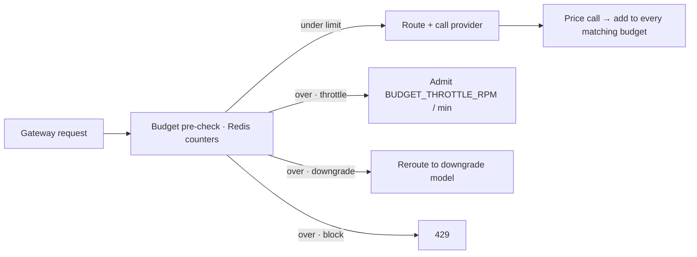

Budgets turn cost visibility into cost *control*. Set a limit on any attribution dimension and choose what
happens when it's approached or breached.

## Key features

- **Scoped limits** — per workspace, end user, feature tag, app, access group, API key, provider profile or **model**.
- **Automatic actions** — **notify**, **throttle**, **block**, **downgrade** or **fallback** to a cheaper model.
- **Durable spend** — spend is stored in Postgres (`budget_spend`); Redis only caches it, so eviction or a Redis restart never resets a budget.
- **Runaway protection** — a run or session in a retry storm is put on hold and the gateway refuses it.
- **Burn-down and forecast** — each budget shows spend this period, the run rate and the date it is forecast to breach.
- **Simulation** — replay the last 30 days of real spend against a budget before you create it.

## Supported scopes

| `scope_type` | `scope_id` | Matches |
|---|---|---|
| `workspace` | none | all traffic |
| `end_user` | end-user id | calls with that `end_user_id` |
| `feature_tag` | tag | runs with that feature tag (the workflow) |
| `app` | application UUID | runs of that application |
| `access_group` | access-group UUID | calls by members of the group |
| `api_key` | API key UUID | calls authenticated by the key |
| `provider_profile` | pricing row UUID | calls billed under that provider price |
| `model` | model name or `prefix*` | calls to matching models; optional `api_key_id` narrows it to one key |

`scope_id` is validated (UUID scopes must exist in the workspace) and there can be only one active
budget per scope, key filter and period: a second one returns `409`. Periods are `daily`, `weekly`
(ISO week, Monday start), `monthly` and `total`, all in UTC.

### Model budgets

Model budgets replaced the separate per-key "model quotas" (which were never enforced). Use
`scope_type: model` with an exact model name (`gpt-4o`) or a prefix pattern (`gpt-4*`), and set
`api_key_id` to cap one key's spend on that model. Existing per-key model quotas with a spend limit
were migrated to model budgets; rate-only quotas (rpm/tpm) were dropped. Model budgets are
checked per candidate route: a route whose model is over budget is skipped, and with no route left
the gateway returns `429`. `/model-budgets` redirects to `/budgets?scope_type=model`.

Access-group budgets are especially useful when a workspace wants one shared financial envelope and downstream billing or chargeback views for a governed member cohort.

## How it works



### Counting spend

Every priced model call is added to every budget it matches. This happens in exactly one place (`record_budget_spend`), called wherever a call gets its cost:

| Source | When it is counted |
|---|---|
| Gateway (`gateway-rs`) | At finalize, right after the call is priced |
| SDK / OTLP / ingest | When the provider-call event carries a `cost_usd` |
| Calls priced later | By the `metering.enrich_costs` worker once pricing is available |

Each call is counted at most once (`budget_spend_calls`), so ingest retries, re-enrichment and `metering.replay_backfill` cannot double count. Spend is added to `budget_spend` (one row per budget per period) in the same transaction that records the call, and written through to a Redis cache that expires after five minutes. A cache miss reads Postgres, so losing Redis never resets a budget. The nightly `budgets.budget_spend_sync` job recomputes each budget's current period from provider calls and reconciles both.

When a counter crosses 80% of the limit, a `budget.threshold_crossed` event is published. When it reaches the limit, a breach is recorded and budget notifications are sent. Both happen once per budget per period, for every action including `notify`.

### Gateway enforcement

Before routing, the gateway checks every budget that matches the request: `workspace`, `end_user`, `feature_tag` (from `metadata.feature_tag`/`workflow` or the first request tag), `api_key` and `access_group`. Then it checks the key's **budget tier**: the key's assigned tier (or the workspace default tier) caps the key's spend across all routes for the tier's period; over it the request gets `429` with the reason `budget_tier:<name>`. `provider_profile` and `model` budgets are checked per candidate route, so an exhausted one skips that route and the request falls through to the next one.

If both Redis and Postgres are unavailable, the check fails open and the request proceeds.

## Actions

| Action | Effect once the limit is reached |
|---|---|
| **Notify** | Records the breach and sends notifications. Traffic is not affected. |
| **Throttle** | The gateway admits `BUDGET_THROTTLE_RPM` requests per minute (default 10) for that budget and rejects the rest with `429` and `Retry-After: 60`. |
| **Block** | The gateway rejects requests with `429` until the period resets or the limit is raised. |
| **Downgrade** / **Fallback** | The gateway reroutes to `downgrade_to_model`, given as a route alias or as a route's target model. If no active route serves it, the request is rejected with `429`. |

Rejected requests carry `X-Cost-Cap-Reason: budget_exceeded` and `X-Budget-Id`. Rerouted and throttled requests record `budget_downgrade:<id>` or `budget_throttle:<id>` in the request's decision reason.

`POST /policies/check` and `GET /budgets/check` report the same five actions: `fallback` is
reported as a model switch (like `downgrade`), `throttle` as allowed but throttled.

## Runaway protection

Every five minutes `budgets.runaway_protection` looks for:

- a **run** or a **session** with more than 20 provider calls in the last two minutes (retry storm);
- a running run with a single call above 100k input tokens (token spike).

It places a 30-minute **hold** on that run or session (`budget_runaway_holds`), marks a running run
cancelled, emails workspace admins and queues a `runaway.detected` notification. While a hold is
active the gateway refuses requests whose metadata names the held run (`runledger.run_id` /
`run_id`) or session (`runledger.session_id` / `session_id` / `session`) with `429`
(`X-Cost-Cap-Reason: runaway_hold`), and `GET /budgets/check?run_id=…&session_id=…` returns
`allowed: false`.

Admins see and manage holds on **Budgets → Runaway holds**: release one early
(`POST /budgets/runaway-holds/{id}/release`) or hold a run or session by hand
(`POST /budgets/runaway-holds`).

## Burn-down, forecast and simulation

`GET /budgets/{id}/burndown` returns cumulative spend for the current period (hourly for daily
budgets, daily otherwise), the run rate over the last seven days of the period, the projected
period total and `forecast_breach_date`, the first point where the projection reaches the limit.
The budget detail page charts it.

`POST /budgets/simulate` replays the last 30 days (`days`, up to 90) of real spend against a
candidate budget, with the same scope rules as enforcement. For each period it reports spend,
when the limit would have been reached and how many calls (and how much cost) came after that
point, the calls the action would have blocked, downgraded or throttled. **Simulate last 30 days**
in the New Budget dialog calls it.

## Overrides

An override raises a budget's limit for a time window. One that starts in the future is
`scheduled` and the `budgets.expire_overrides` worker (every five minutes) activates it at
`starts_at` and expires it at `expires_at`, refreshing the gateway's cache each time. Overrides
that need approval stay `pending` until approved in **Approvals**. Any override above 1.5× the
budget's limit requires approval, even if the requester didn't ask for it.

## Alert metrics

Alert rules can watch `budget_utilization` (highest percent used by any active budget this period)
and `budget_breach_count` (breaches in the alert window).

See [`examples/180_workflow_budget_gateway.py`](https://github.com/avs6/runledger-community/blob/master/examples/180_workflow_budget_gateway.py) for a workflow budget enforced by the gateway. To verify counting, breaches and enforcement end to end against a running stack:

```powershell
python scripts/run_demo.py verify-budgets
```

## Per-user spend breakdown

Budget detail now includes a per-user spend breakdown table. When a budget has `end_user_id` attribution on its provider calls, the detail view shows each user's share of the budget spend — cost, run count, call count, and percentage of total. This is available on the budget detail page and via `GET /budgets/{id}/breakdown`.

Platform users can also view their own financial exposure at `/users/{id}`, which shows 30-day and total spend, run/call counts, and any budgets scoped to their identity.

## Enforcement modes

- **Inline (gateway)** — enforced before the provider call, as described above.
- **Out-of-band (SDK)** — a pre-check (`GET /budgets/check?model=…&run_id=…&session_id=…`) you can choose to block on. It covers model budgets and runaway holds too. Spend from SDK traffic still counts toward the budget.

## Breach notifications

Webhook and Slack destinations receive `budget.breach` and `runaway.detected` events
(`/budgets/notifications`, workspace admin). Destination URLs must be public — private,
loopback and metadata addresses are refused.

Deliveries are queued, not sent inline: each event creates one `pending` delivery per
destination, and `budgets.deliver_notifications` (every 60 seconds, and right after a breach)
sends it. A failed delivery is retried after 1, 2, 4 and 8 minutes and marked `failed` after
five attempts. `GET /budgets/notifications/{id}/deliveries` shows every attempt.

Webhook deliveries are signed with **that destination's own secret**:
`X-RunLedger-Signature: sha256=<hex HMAC-SHA256 of the raw body>`. Fetch it with
`GET /budgets/notifications/{id}/signing-secret` and rotate it with
`POST /budgets/notifications/{id}/signing-secret/rotate` (the old secret stops working).
One destination's secret can't verify or forge another's deliveries.

## Access-group budget scoping

Access groups are first-class budget scopes. When you set `scope_type: access_group` and point `scope_id` at an access-group UUID, every call made by a member of that group is counted against the budget and enforced in the gateway.

A call is attributed to a member in this order:

1. the owner of the dashboard session key;
2. the creator of a user-owned API key;
3. an `end_user_id` that is a workspace member's user id or email.

This is the same mapping the gateway uses for access-group guardrail profiles. A user in several groups counts against each group's budgets.

Typical workflow:

1. Create the access group in **Organization → Access Groups** (or `POST /access-groups`).
2. Create a budget with `scope_type: access_group` and the group's UUID as `scope_id`.
3. Members are evaluated against the budget automatically on the gateway hot path.
4. View the **Org & Access Scope Context** card on the budget detail page to see group membership, workspace-level spend, and AI Hub model usage.

Overrides also support access-group scoping — the override inherits the parent budget's scope, so a temporary limit bump applies to the same member cohort.

See [`examples/49_access_group_budget_scope.py`](https://github.com/avs6/runledger-community/blob/master/examples/49_access_group_budget_scope.py).

## API-key budget scoping

API keys are first-class budget scopes. When you set `scope_type: api_key` and point `scope_id` at a key UUID, every request authenticated with that key is metered against the budget. This is useful for service-account isolation, per-integration spend caps, and key-level chargeback.

Typical workflow:

1. Create the API key in **Organization → API Keys** (or `POST /settings/api-keys`).
2. Create a budget with `scope_type: api_key` and the key's UUID as `scope_id`.
3. All traffic bearing that key is metered against the budget.
4. The budget detail page shows key-level context (name, prefix, ownership type) in the **Org & Access Scope Context** card.

See [`examples/48_api_key_budget_scope.py`](https://github.com/avs6/runledger-community/blob/master/examples/48_api_key_budget_scope.py).

## Related

<CardGroup cols={2}>
  <Card title="Runtime controls" icon="sliders" href="/gateway/runtime-controls">
    Per-route cost caps + rate limits.
  </Card>
  <Card title="Cost attribution" icon="building" href="/finops/attribution">
    The dimensions you budget on.
  </Card>
</CardGroup>

See [`examples/08_budget_enforcement.py`](https://github.com/avs6/runledger-community/blob/master/examples/08_budget_enforcement.py).
