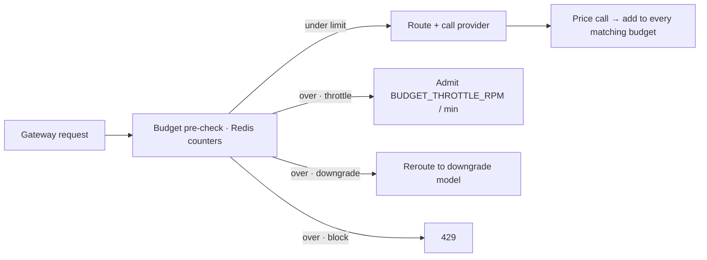

Budgets turn cost visibility into cost *control*. Set a limit on any attribution dimension and choose what
happens when it's approached or breached.

## Key features

- **Scoped limits** — per workspace, end user, feature tag, access group, API key, or provider profile.
- **Automatic actions** — **throttle**, **block**, or **downgrade** to a cheaper model.
- **Runaway protection** — a background job catches sudden spikes between rollups.
- **Fast enforcement** — spend counters live in Redis, so a pre-check adds negligible latency.

## Supported scopes

The current shipped budget scope model is:

- `workspace`
- `end_user`
- `feature_tag`
- `access_group`
- `api_key`
- `provider_profile`

Access-group budgets are especially useful when a workspace wants one shared financial envelope and downstream billing or chargeback views for a governed member cohort.

## How it works



### Counting spend

Every priced model call is added to every budget it matches. This happens in exactly one place (`record_budget_spend`), called wherever a call gets its cost:

| Source | When it is counted |
|---|---|
| Gateway (`gateway-rs`) | At finalize, right after the call is priced |
| SDK / OTLP / ingest | When the provider-call event carries a `cost_usd` |
| Calls priced later | By the `metering.enrich_costs` worker once pricing is available |

Each call is counted at most once, so ingest retries, re-enrichment and `metering.replay_backfill` cannot double count. Counters live in Redis per budget and period (`daily`, `monthly`, `total`).

When a counter crosses 80% of the limit, a `budget.threshold_crossed` event is published. When it reaches the limit, a breach is recorded and budget notifications are sent. Both happen once per budget per period, for every action including `notify`.

### Gateway enforcement

Before routing, the gateway checks every budget that matches the request: `workspace`, `end_user`, `feature_tag` (from `metadata.feature_tag`/`workflow` or the first request tag), `api_key` and `access_group`. `provider_profile` budgets are checked per candidate route, so an exhausted provider budget skips that route and the request falls through to the next one.

If Redis is unavailable, the check fails open and the request proceeds.

## Actions

| Action | Effect once the limit is reached |
|---|---|
| **Notify** | Records the breach and sends notifications. Traffic is not affected. |
| **Throttle** | The gateway admits `BUDGET_THROTTLE_RPM` requests per minute (default 10) for that budget and rejects the rest with `429` and `Retry-After: 60`. |
| **Block** | The gateway rejects requests with `429` until the period resets or the limit is raised. |
| **Downgrade** / **Fallback** | The gateway reroutes to `downgrade_to_model`, given as a route alias or as a route's target model. If no active route serves it, the request is rejected with `429`. |

Rejected requests carry `X-Cost-Cap-Reason: budget_exceeded` and `X-Budget-Id`. Rerouted and throttled requests record `budget_downgrade:<id>` or `budget_throttle:<id>` in the request's decision reason.

See [`examples/180_workflow_budget_gateway.py`](https://github.com/avs6/runledger-community/blob/master/examples/180_workflow_budget_gateway.py) for a workflow budget enforced by the gateway. To verify counting, breaches and enforcement end to end against a running stack:

```powershell
python scripts/run_demo.py verify-budgets
```

## Per-user spend breakdown

Budget detail now includes a per-user spend breakdown table. When a budget has `end_user_id` attribution on its provider calls, the detail view shows each user's share of the budget spend — cost, run count, call count, and percentage of total. This is available on the budget detail page and via `GET /budgets/{id}/breakdown`.

Platform users can also view their own financial exposure at `/users/{id}`, which shows 30-day and total spend, run/call counts, and any budgets scoped to their identity.

## Enforcement modes

- **Inline (gateway)** — enforced before the provider call, as described above.
- **Out-of-band (SDK)** — an advisory pre-check (`GET /budgets/check`) you can choose to block on. Spend from SDK traffic still counts toward the budget.

## Breach notifications

Webhook and Slack destinations receive `budget.breach` and `runaway.detected` events
(`/budgets/notifications`, workspace admin). Destination URLs must be public — private,
loopback and metadata addresses are refused.

Webhook deliveries are signed with **that destination's own secret**:
`X-RunLedger-Signature: sha256=<hex HMAC-SHA256 of the raw body>`. Fetch it with
`GET /budgets/notifications/{id}/signing-secret` and rotate it with
`POST /budgets/notifications/{id}/signing-secret/rotate` (the old secret stops working).
One destination's secret can't verify or forge another's deliveries.

## Access-group budget scoping

Access groups are first-class budget scopes. When you set `scope_type: access_group` and point `scope_id` at an access-group UUID, every call made by a member of that group is counted against the budget and enforced in the gateway.

A call is attributed to a member in this order:

1. the owner of the dashboard session key;
2. the creator of a user-owned API key;
3. an `end_user_id` that is a workspace member's user id or email.

This is the same mapping the gateway uses for access-group guardrail profiles. A user in several groups counts against each group's budgets.

Typical workflow:

1. Create the access group in **Organization → Access Groups** (or `POST /access-groups`).
2. Create a budget with `scope_type: access_group` and the group's UUID as `scope_id`.
3. Members are evaluated against the budget automatically on the gateway hot path.
4. View the **Org & Access Scope Context** card on the budget detail page to see group membership, workspace-level spend, and AI Hub model usage.

Overrides also support access-group scoping — the override inherits the parent budget's scope, so a temporary limit bump applies to the same member cohort.

See [`examples/49_access_group_budget_scope.py`](https://github.com/avs6/runledger-community/blob/master/examples/49_access_group_budget_scope.py).

## API-key budget scoping

API keys are first-class budget scopes. When you set `scope_type: api_key` and point `scope_id` at a key UUID, every request authenticated with that key is metered against the budget. This is useful for service-account isolation, per-integration spend caps, and key-level chargeback.

Typical workflow:

1. Create the API key in **Organization → API Keys** (or `POST /settings/api-keys`).
2. Create a budget with `scope_type: api_key` and the key's UUID as `scope_id`.
3. All traffic bearing that key is metered against the budget.
4. The budget detail page shows key-level context (name, prefix, ownership type) in the **Org & Access Scope Context** card.

See [`examples/48_api_key_budget_scope.py`](https://github.com/avs6/runledger-community/blob/master/examples/48_api_key_budget_scope.py).

## Related

<CardGroup cols={2}>
  <Card title="Runtime controls" icon="sliders" href="/gateway/runtime-controls">
    Per-route cost caps + rate limits.
  </Card>
  <Card title="Cost attribution" icon="building" href="/finops/attribution">
    The dimensions you budget on.
  </Card>
</CardGroup>

See [`examples/08_budget_enforcement.py`](https://github.com/avs6/runledger-community/blob/master/examples/08_budget_enforcement.py).
