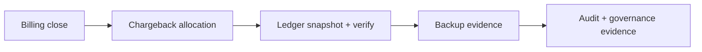

RunLedger's ledger is the compliance-close layer for FinOps. It is no longer best understood as a standalone workspace page. The real operator home is **Platform Settings -> Compliance**, while `/ledger` remains a compatibility route for legacy navigation and API entry.

## What exists today

- **Sealed daily snapshots** - each UTC day is sealed once: totals, a per-call manifest and the previous snapshot's hash, signed with HMAC-SHA256 (per-workspace key). A sealed snapshot is never overwritten.
- **On-demand sealing** - platform admins can seal yesterday (or a past `snapshot_date`) immediately; if the day is already sealed the existing snapshot is returned (200).
- **Integrity verification** - verification checks the signature, the chain link and every sealed call against the live rows, so late data isn't mistaken for tampering.
- **Closure summary** - the Compliance tab now shows ledger status together with latest billing close, chargeback evidence, backup evidence, and audit activity.
- **Evidence chain links** - operators can jump from compliance closure into Billing, Chargeback, Audit Log, and Tool Registry.

## Platform ownership

Ledger is now owned under **Platform Settings -> Compliance** because the user question is not just:

- "Did a snapshot exist?"

It is also:

- "Was the billing period closed?"
- "Was ownership allocation reviewed?"
- "Is there backup evidence?"
- "Do we have audit activity and governance evidence for the close?"

That makes Ledger a **closure workflow**, not a standalone daily operating page.

## API surfaces

- `GET /ledger/closure-summary`
- `GET /ledger/snapshots`
- `POST /ledger/snapshots/generate`
- `GET /ledger/verify/{snapshot_date}`

## Sealing and verification

For every successful provider call of the day the snapshot stores a hash of the call's canonical
fields (id, run, API key, end user, provider, model, token counts, status, time and cost) and the
cost at sealing time (`ledger_snapshot_entries`). The signature covers the totals, the digest of
that manifest and the previous snapshot's hash, so snapshots form a chain.

`GET /ledger/verify/{snapshot_date}` returns one of:

| `status` | Meaning |
|---|---|
| `ok` | Signature, chain and every sealed call match. |
| `late_data` | Only honest late data: calls priced after sealing (`late_enriched_rows`) or recorded after sealing (`late_arrival_rows`). |
| `incomplete` | Sealed calls no longer exist (`missing_rows`), e.g. removed by retention. |
| `tampered` | The signature or chain link doesn't match, or a sealed call's user, key, model, tokens or cost changed (`modified_rows`). |
| `unsealed_drift` | A legacy aggregate-only snapshot (sealed before this change) whose totals differ; it can't tell late data from tampering. |
| `not_found` | No snapshot for that day. |

Moving cost between users, keys or workspaces is detected even when per-model totals are preserved.
The signing key still lives (encrypted with `LEDGER_MASTER_KEY`) in the database it attests;
anchoring the chain off-box is not implemented.

## Closure workflow

## Closure summary fields

| Field | Purpose |
|---|---|
| `readiness_status` | Overall close posture: `ready`, `partial`, `at_risk`, or `empty` |
| `evidence_score` | Quick score across billing, snapshot, verification, chargeback, and backup evidence |
| `missing_evidence` | Explicit list of what is still missing before the close package is trustworthy |
| `latest_closed_period` | Most recent closed billing period |
| `latest_snapshot` | Most recent signed ledger snapshot |
| `verification` | Counts of verified, tampered, and pending snapshots |
| `chargeback` | Current allocation posture used as ownership evidence |
| `latest_backup_snapshot` | Latest backup evidence record |
| `recent_audit_event_count` | Recent audit activity that supports the close trail |

## Related

<CardGroup cols={2}>
  <Card title="Billing" icon="receipt" href="/finops/billing">
    Close accounting periods and prepare the upstream evidence chain.
  </Card>
  <Card title="Chargeback" icon="building" href="/finops/chargeback">
    Review ownership allocation before treating the close package as complete.
  </Card>
</CardGroup>

See [`examples/11_ledger_verify.py`](https://github.com/avs6/runledger-community/blob/master/examples/11_ledger_verify.py).
