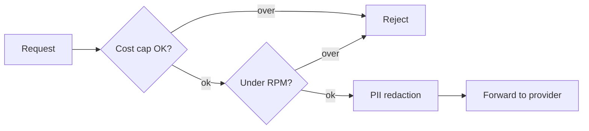

Because inference flows *through* the gateway, RunLedger can enforce controls **in the request path** —
a runaway agent is throttled or blocked before it ever reaches (and bills) the provider.

## Cost caps

Set a daily and/or monthly USD ceiling per route (values must be 0 or more). When the route's spend crosses
the cap, the gateway tries the next eligible route; if no route is left, the request is rejected with
**429**, an `X-Cost-Cap-Reason` header (`daily_limit_exceeded`, `monthly_limit_exceeded`,
`budget_tier_exceeded` or `budget_exceeded`) and a `Retry-After` (seconds until the window resets), so
clients can tell a spend stop from an outage.

Spend is priced from the route's provider and model using the same provider pricing as the ledger (this
workspace's override first, then the global price). Self-hosted providers (`ollama`, `vllm`, `local`,
`lmstudio`, `llamacpp`) cost nothing unless you add a price for them. A hosted model is never given a
guessed price: saving a cap on a route whose model has no price returns **422** — add the price under
**Provider Profiles** first. If a price is removed later, the cap is skipped and
`gateway_cost_cap_unpriced_model` is logged.

```json
{
  "daily_cost_limit_usd": 50.00,
  "monthly_cost_limit_usd": 1000.00
}
```

## Per-user rate limits

Limit requests-per-minute per end user on a route. Pass the user via the
`X-RunLedger-End-User-Id` header; without it the limit applies per API key, so leaving the header out
doesn't bypass it. The limit is a true sliding 60-second window, checked atomically in Redis on the hot
path (concurrent requests can't overshoot it, and refused requests don't use a slot). Only the route
expected to serve the request takes a slot; fallback routes are checked but count only when they become
the first runnable route. Cache hits count too. A breach that leaves no other eligible route returns
**429** with `Retry-After` (seconds until a slot frees). If Redis is unavailable the limit fails open and
logs `gateway_per_user_rpm_redis_error`.

```json
{ "per_user_rpm_limit": 60 }
```

## PII redaction

When enabled on a route, message content is scrubbed of common PII patterns (emails, phone numbers, SSNs,
card numbers) right after pre-call guardrails and **before** the exact and semantic caches, the Context
Compiler, the intelligent-routing classifier and the provider see it. It applies to streamed and
non-streamed requests alike, and to every fallback route that has it enabled.

```json
{ "pii_redaction_enabled": true }
```

## Post-call blocks

A `post_call` guardrail that blocks a response returns **451** to the client, but the provider call
already happened, so RunLedger still records it: a failed run with its tokens and cost, a gateway request
with `status: blocked` and a `guardrail_blocked: <reason>` decision, and the spend against every
matching budget. Blocked responses are never cached. Post-call rules see the response text and the arguments of any
tool calls the model returned (`texts`, `tool_calls`).

## Custom guardrail logic

Guardrail rules of type `custom` (and the built-in templates) are written in a small
Python-like language. RunLedger parses the logic and runs it in its own interpreter —
it never calls `exec` or `eval` — so a rule can only use what the language allows:

- inputs: `texts`, `images`, `tools`, `tool_calls`, `structured_messages`, `model`,
  `user_id`, `end_user_id`, `metadata`;
- statements: assignment, `if`/`elif`/`else`, `for`, `break`/`continue`, comprehensions,
  f-strings; `import re` is accepted (`re` is always available);
- functions: `allow()`, `block(reason)`, `modify(texts=…, images=…, tool_calls=…)` and
  `len str int float bool list dict set tuple range enumerate zip any all min max sum
  abs sorted reversed isinstance round`;
- methods: common `str` methods, `list.append/extend/index/count`,
  `dict.get/items/keys/values`, `re.search/match/fullmatch/findall/sub/split` and
  match-object `group/groups/start/end/span`.

Set `result` to the decision:

```python
combined = " ".join(texts).lower()
if re.search(r"(api[_-]?key|password)", combined):
    result = block("Credential material detected")
else:
    result = allow()
```

Anything else — other attributes, dunder names, function or class definitions,
`lambda`, `while`, `try`, other imports — is rejected when the rule is saved (422,
"Invalid guardrail logic: …"). At run time each rule has a step budget, its timeout,
a 10,000-iteration loop limit and size caps (1 MB strings, 100,000-item collections).
A rule that errors or exceeds a limit lets the request through and records the reason,
so a broken rule can't take the gateway down. Creating or editing rules needs a
workspace admin.

## Health auto-disable

A route that fails health checks repeatedly is automatically taken out of rotation (`health_auto_disable`),
so fallback routes absorb the traffic until it recovers.

## How it fits



All controls are set per route on the **Gateway** dashboard page or via `POST/PUT /gateway/routes`.

## Related

<CardGroup cols={2}>
  <Card title="Budgets" icon="shield-check" href="/finops/budgets">
    Workspace / user / feature spend limits with automatic actions.
  </Card>
  <Card title="Billing Periods" icon="calendar" href="/finops/billing">
    Period-level throttle economics and cost attribution.
  </Card>
  <Card title="Data retention" icon="clock-rotate-left" href="/governance/retention">
    Control how long payloads and telemetry are kept.
  </Card>
  <Card title="Runs" icon="play" href="/observe/runs">
    Guardrail enforcement outcomes visible in run investigation.
  </Card>
  <Card title="Monitoring" icon="monitor-waveform" href="/observe/monitoring">
    Guardrail firing rates and latency impact in live dashboards.
  </Card>
</CardGroup>

## Why this route: `X-RunLedger-Decision`

Every gateway response carries an `X-RunLedger-Decision` header summarising what the gateway decided:

```
X-RunLedger-Decision: route=chat/openai:gpt-4o-mini; trigger=primary; cache=miss; budget=ok; guardrail=pass; prompt=triage@2
```

`route` is the alias, provider and model that actually served (after any fallback, `trigger` says why:
`primary`, `configured`, `request`, `policy`, `timeout`, `content_policy`, `context_window`). A cache hit
reads `route=cache; cache=exact` (or `semantic`). `budget` is `ok`, `downgrade`, `fallback`, `throttle` or
`skipped`; `guardrail` is `pass`, `modified` or `off`.

The full record — candidates in try order, routes skipped by cost caps, the budget that rerouted the
request, intelligent-routing output and the resolved prompt — is stored on the run
(`run_metadata.gateway_decision`), returned by `GET /gateway/runs/{run_id}/decision`, and shown in the
**Why this route** panel on the run detail page.

## Attribution

Preflight mints a `request_id` that gateway-rs echoes on finalize, mirror and runtime events. The gateway
request row uses it as its id and persists `run_id`, `api_key_id` and `workflow`; guardrail events carry the
same three and are linked to the run when it is recorded. Runs, the request explorer and
`GET /gateway/requests?run_id=…&workflow=…&api_key_id=…` join on these keys — nothing is matched by time window.

## Prompt refs

A request can name a managed prompt instead of carrying its own system message:

```json
{"model": "chat", "prompt": "support-triage@prod", "prompt_variables": {"product": "RunLedger"},
 "messages": [{"role": "user", "content": "Ticket 42: refund?"}]}
```

`name` uses the prompt's default environment, `name@prod|staging|dev|<env>` the latest version in that
environment, `name@3` (or `@v3`) an exact version. `{{variable}}` placeholders are filled from
`prompt_variables` (missing ones are left in place and listed in the decision). The rendered prompt is
prepended as the system message **before** guardrails run, and the run's `deployment_version` is
`name:version`, so gateway traffic appears in the prompt's version metrics. An unknown prompt or version is
a 404.

## Pass-through governance

`/gateway/passthrough/{slug}/…` runs a governance preflight before the upstream is called:
required metadata (`X-RunLedger-Metadata` JSON header), request budgets for the workspace, key, end user
(`X-RunLedger-End-User-Id`) and workflow (`X-RunLedger-Workflow`) — 429 when exhausted — and pre-call
guardrails on the request body (451 on block; a `modify` result can't be applied to an opaque body, so it is
recorded as `guardrail_modify_not_applied` and the body is forwarded unchanged). The endpoint's
`cost_per_call_usd` counts against the same budgets. Upstream redirects are **never followed**: a 3xx is
returned to the caller without its `Location` header.

