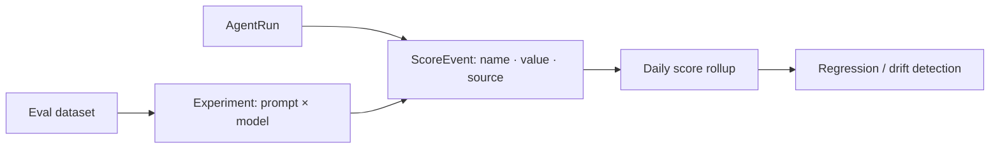

Evaluations attach **quality scores** to runs; experiments compare **prompt × model × dataset** combinations
so you can pick the best configuration and catch regressions before they ship.

<Frame caption="Evaluations & experiments — quality scores, regressions, and prompt × model × dataset runs.">
  
</Frame>

## Key features

- **Score events** — a `name`, `value`, and `source` (`human` / `heuristic` / `llm_judge`) per run or span.
- **LLM-as-judge, through the gateway** — the judge's `model` is a gateway route alias and it calls
  gateway-rs, so judge spend is governed, metered and budgeted. Its RunLedger key is write-only
  (`gateway_api_key` in, stored encrypted as `gateway_key_ref`, never returned); provider keys and
  `base_url` are rejected, and creating or changing a judge needs a workspace admin. The judge reads each
  run's captured input and output; runs without a capture are skipped, not scored blind.
- **Experiments** — one system with two modes, both run for real through the gateway: `eval` sends dataset
  inputs (with an optional prompt version as the system prompt), `replay` re-runs the captured conversations
  of recorded runs. The old Replay Lab is this `replay` mode.
- **Regression tracking** — daily score rollups surface drops over time.

## How it works



## Score a run

```python
rl.score("relevance", 0.92, run_id=run_id, source="human")   # value is 0–1
```

Or `POST /evaluations` / `POST /scores`. Scores feed `quality_optimized` routing and the
[optimization flywheel](/optimization/flywheel)'s quality signal.

## Experiments

```bash
# dataset (eval items have input + optional expected_output)
curl -X POST $API/datasets -d '{"name": "smoke", "items": [{"input": "2+2?", "expected_output": "4"}]}'
# or curate a replay dataset from recorded runs (needs captured payloads)
curl -X POST $API/datasets/from-runs -d '{"name": "regressions", "run_ids": ["<run>", "<run>"]}'
# experiment: route aliases to compare, first one is the baseline
curl -X POST $API/experiments -d '{"name": "smoke", "mode": "eval", "dataset_id": "<id>",
  "models": [{"model": "smart"}, {"model": "fast"}], "evaluator_ids": ["<judge>"]}'
curl -X POST "$API/experiments/<id>/run?wait=true"     # or omit wait and poll GET /experiments/<id>
curl -X POST $API/experiments/<id>/recommend-route     # → pending Flywheel recommendation
```

Each item × model is a gateway call with your key (budgets, guardrails and routing apply) recorded as a run
with `feature_tag=experiment`. Outputs are scored by the experiment's evaluators and, when an item has an
`expected_output`, by an expected-output match; scores are stored on the recorded runs, so they feed
scorecards and the prompt promotion gate. Results hold per-model score, latency, cost and deltas against
the baseline, plus per-item outputs. `recommend-route` turns the cheapest model that holds the baseline's
quality (or the best scorer) into a Flywheel recommendation you apply from **Optimization**, with audit and
rollback. See the **Experiments** page (`/experiments`, `/experiments/{id}`).

## Related

<CardGroup cols={2}>
  <Card title="Prompt registry" icon="code-branch" href="/governance/prompts">
    Version the prompts you evaluate.
  </Card>
  <Card title="Outcomes & ROI" icon="chart-line" href="/finops/outcomes">
    Business outcomes vs eval scores.
  </Card>
</CardGroup>

See [`examples/14_evaluations.py`](https://github.com/avs6/runledger-community/blob/master/examples/14_evaluations.py).
