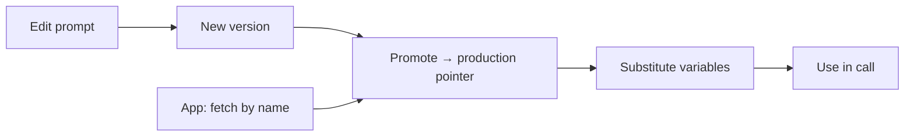

The prompt registry treats prompts as versioned artifacts: edit, diff, promote, and fetch by name at
runtime — so a prompt change is auditable and reversible instead of a silent code edit.

<Frame caption="Prompt registry — versioning, diff viewer, and promote-to-production.">
  
</Frame>

## Key features

- **Versioning** — every edit is a new immutable version.
- **Diff viewer** — a server-computed line diff between any two versions (`GET /prompts/{name}/diff?from=&to=`).
- **Governed production** — new versions land in `dev`; every way into `production` (create, edit,
  promote, GitHub pull) needs an approved `prompt_promote` approval for that prompt, and each approval
  authorises exactly one production version.
- **Score gate** — set `promotion_min_score` (0–1) and promotion is refused until the candidate version
  scores at least that much, from its latest experiment or its scored runs.
- **Variable substitution** — `{{variables}}` filled at fetch time.
- **GitHub sync** — optionally back the registry with a repo.

## How it works



## Promote to production

```bash
# 1. Ask for approval for the latest staging version (normal approvals queue,
#    auto-approval policies and notifications apply)
curl -X POST $API/prompts/support-reply/promotion-requests -H "Authorization: Bearer $KEY" \
  -d '{"source_environment": "staging", "reason": "friendlier tone"}'
# 2. An approver approves it in Approvals (or POST /approvals/{id}/approve)
# 3. Promote with that approval
curl -X POST $API/prompts/support-reply/promote -H "Authorization: Bearer $KEY" \
  -d '{"source_environment": "staging", "target_environment": "production", "approval_id": "<id>"}'
```

Without an approval the API answers `403`; reusing an approval is `409`; an approval pinned to another
version, or a candidate below the score gate, is `409` with the reason. `GET
/prompts/{name}/promotion-requests` lists the approvals and the version each was used for, and `GET
/prompts/{name}/versions/{v}/score` shows the score the gate checks. In the dashboard, the prompt page's
**Promotion to production** panel does all of this. Set or clear the gate with `PATCH /prompts/{name}`
(`promotion_min_score`, `promotion_score_name`, `clear_promotion_gate`).

## Fetch at runtime

```python
prompt = rl.get_prompt("support-reply", variables={"tone": "friendly"})
resp = client.chat.completions.create(
    model="gpt-4o-mini",
    messages=[{"role": "system", "content": prompt["content"]}, ...],
)
```

`get_prompt(name, environment="production", variables=...)` returns a dict — `content` (the rendered
string), `version`, `environment`, `model_hint`, and the `variables` schema. The app always fetches the
**production** version by name; promoting a new version rolls everyone forward
(and rolling back is just re-promoting the previous one). Runs record the
`deployment_version` so you can tie quality and cost to a specific prompt version.

## Related

<CardGroup cols={2}>
  <Card title="Evaluations" icon="flask" href="/governance/evaluations">
    Score prompt versions before promoting.
  </Card>
  <Card title="Approvals" icon="user-check" href="/governance/approvals">
    Gate promotion behind an approval.
  </Card>
</CardGroup>

See [`examples/15_prompts.py`](https://github.com/avs6/runledger-community/blob/master/examples/15_prompts.py).
