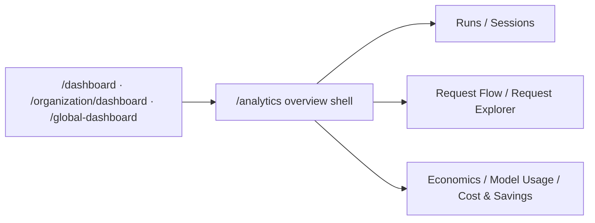

Analytics is the main Observe landing surface. It is the shared overview shell for:

- workspace operators coming from `/dashboard`
- organization administrators coming from `/organization/dashboard`
- platform administrators coming from `/global-dashboard`

<Frame caption="Analytics overview — one scoped entry point for workload health, spend, model mix, and request-analysis drill-downs.">
  
</Frame>

## Key features

- **Scoped overview** — switch between workspace, organization, and platform perspectives.
- **Top intents** — see which workflows are driving demand and cost in the current scope.
- **Request-analysis bridge** — jump directly into Runs, Request Flow, and Request Explorer.
- **Model mix** — inspect which providers and models dominate the selected window.
- **Recent activity** — review the latest runs or scope summary without leaving the overview.
- **Breakdown handoff** — use Analytics Breakdown for denser workspace charting when you need deeper charts.

## How it works



## One summary, one set of filters

Every KPI tile comes from one computation (`services/observe.compute_summary`) behind both
`GET /analytics/summary` and `GET /analytics/scoped-summary`: spend is billable cost, usage counts
successful calls, and the previous period uses the same filters. The **Success** tile is
`success_rate` from the API: succeeded ÷ (succeeded + failed) over every run in the window.

`summary`, `spend-over-time`, `spend-by-model` and `spend-by-feature` all take `scope`
(`workspace`, `org`, `platform`) and `access_group_id` (workspace scope only), so the charts
below the KPIs show the same slice as the tiles. Org scope needs an org admin or manager;
`scoped-summary` returns `allowed_scopes` and the page hides the scopes the caller can't use.
Access-group status filters accept either vocabulary (`succeeded`/`failed` or `success`/`error`).

Hourly and daily spend series and spend-by-model read the `usage_hourly` rollup for the hours it
has covered and raw provider calls only for the newer hours (`source: "rollup+raw"`); minute
buckets, API-key filters and access groups with status filters stay on raw calls. A chart that
fails to load shows an error strip with a retry instead of an empty card.

## Governance-aware investigation

All investigation surfaces also accept governance-dimension filters (`tag`, `tool_name`, `security_event_only`) that narrow results to runs matching a governance tag, a specific tool, or runs with correlated security events. The per-run governance context endpoint (`GET /runs/{run_id}/governance`) returns tool policy outcomes, security events, alert firings, audit log entries, and governance pack evidence.

## Related context

Pages no longer load a stack of cross-feature context cards on every visit. Instead, the analytics
overview, API key, budget, workflow and prompt pages have a **Related** button that opens a drawer
on demand. It calls `GET /context?entity=<workspace|workflow|api_key|route|budget|prompt>&id=<id>`,
which returns the entity's last-30-day runs, spend and failures plus the budgets, policies and
guardrails that apply to it, each with a link to the page where you can act.

```bash
curl -s "$RUNLEDGER_URL/context?entity=api_key&id=$KEY_ID" -H "Authorization: Bearer $RUNLEDGER_API_KEY"
```

## Related

<CardGroup cols={3}>
  <Card title="Runs" icon="activity" href="/observability/runs">
    Inspect the concrete executions behind the overview metrics.
  </Card>
  <Card title="Request Flow" icon="git-branch" href="/observability/request-flow">
    Follow routing and outcome causality across the request path.
  </Card>
  <Card title="Economics" icon="wallet" href="/observability/economics">
    Continue into spend, savings, and optimization outcomes.
  </Card>
</CardGroup>

See [`examples/07_analytics_query.py`](https://github.com/avs6/runledger-community/blob/master/examples/07_analytics_query.py).
