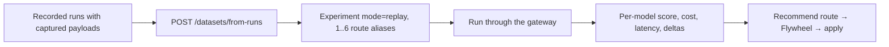

Replay is a mode of [experiments](/governance/evaluations#experiments). The old Replay Lab only projected
cost from token counts; replay experiments now send each captured conversation through the gateway again,
once per route alias, and record real responses, cost and latency.

## Workflow

- Replays need the original messages, so only runs captured under a `SAMPLED`/`FULL` capture policy can
  be added; others are reported and skipped.
- Set `use_output_as_expected` when curating to score replies against the recorded answer (a regression
  check).
- `/replay` and `/replay/{id}` in the dashboard redirect to `/experiments?mode=replay` and
  `/experiments/{id}`.

## Related

<CardGroup cols={2}>
  <Card title="Evaluations & experiments" icon="flask" href="/governance/evaluations">
    Datasets, evaluators and the eval mode.
  </Card>
  <Card title="Optimization flywheel" icon="rotate" href="/optimization/flywheel">
    Apply a recommended route with audit and rollback.
  </Card>
</CardGroup>

See [`examples/10_replay_experiment.py`](https://github.com/avs6/runledger-community/blob/master/examples/10_replay_experiment.py).
