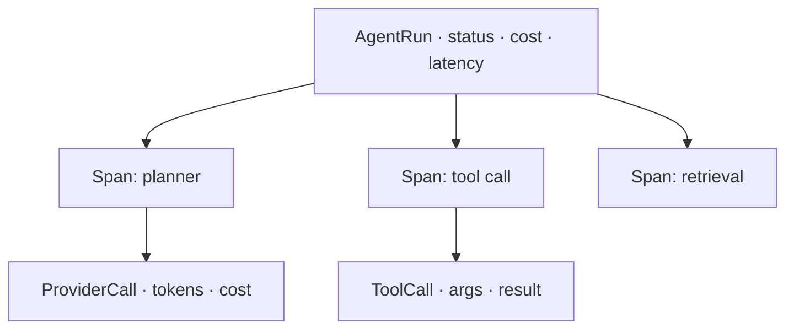

The Run Explorer is where you inspect individual agent runs: filter and paginate, open the execution DAG,
and see exactly where the time and money went.

<Frame caption="Run Explorer — filter runs, open the DAG viewer, export CSV.">
  
</Frame>

## Key features

- **Filter & paginate** — status, workflow (feature tag), end user, model (suggested from the
  models this workspace actually used), cost range, API key, access group, governance tag, tool,
  security-only, time. Filters live in the URL.
- **Keyset paging** — `GET /runs` pages on `(started_at, id)`; pass back `next_cursor`. Runs that
  share a timestamp are never skipped. An unknown `status` or a malformed cursor returns 422.
  `include_total=false` skips the `COUNT(*)` (the total is also sent as `X-Total-Count`).
- **Server aggregates** — the hero tiles come from `GET /runs/stats` (total, success rate,
  cost, tokens, average and p95 duration) over every matching run, not the loaded page.
- **Saved views** — name the current filters and reapply them later (`/runs/saved-views`,
  per user; also on Request Explorer and Sessions).
- **DAG viewer and trace waterfall** — the run's `AgentRun → Span → ProviderCall / ToolCall`
  tree, plus a waterfall on a shared time axis with copyable run and span ids.
- **Compare two runs** — `/runs/compare?a=&b=` (or “Compare with…” on a run) shows cost,
  tokens, duration, calls, tools and errors side by side with the difference.
- **CSV / PDF export** — `GET /runs/export` takes exactly the list filters, including the
  default 7-day window.

## Captured payloads

Prompts and responses captured by a `SAMPLED`/`FULL` capture policy appear once per span in
`span_payloads` (plus the first input/output), never inside span metadata. They are returned
only to platform admins, org admins/managers/auditors, workspace members with a writable role,
and workload keys without scopes or with `write`. Everyone else gets metadata with
`payloads_redacted: true`, and the UI says so.

## The run tree

Every run is trace-linked to its metering, so the DAG doubles as a cost breakdown — the basis for
[cost attribution](/finops/attribution) and [unit economics](/finops/attribution#unit-economics).

## Related

<CardGroup cols={2}>
  <Card title="Sessions" icon="comments" href="/observability/sessions">
    Group runs into conversations.
  </Card>
  <Card title="Analytics" icon="chart-mixed" href="/observability/analytics">
    Aggregate across runs.
  </Card>
</CardGroup>

See [`examples/10_replay_experiment.py`](https://github.com/avs6/runledger-community/blob/master/examples/10_replay_experiment.py).
