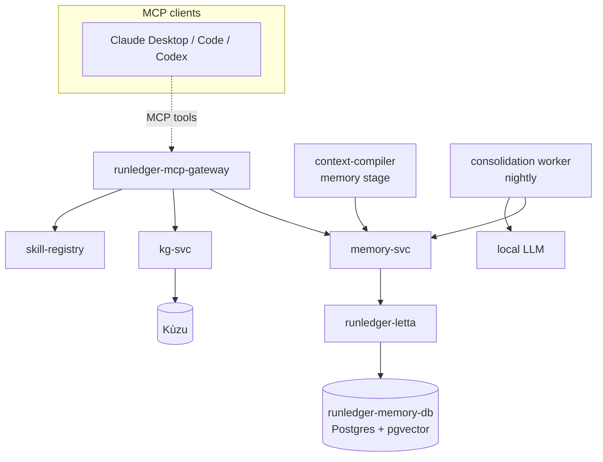

The cognitive layer gives RunLedger **memory**. Instead of every client re-sending the same context,
they draw on a shared, workspace-scoped store of **facts**, a **knowledge graph** of entities and
relationships, and a **skill registry** — and the Context Compiler can pull the minimal relevant facts
into a request instead of dumping documents.

## How it works



Everything is **workspace-scoped**: the MCP gateway derives the workspace from the caller's RunLedger API key (see [Access control](#access-control)). Downstream calls are **fail-open**, so a client session is never broken by a backing service being unavailable. Authentication is never fail-open.

## Memory (Letta-backed)

Persistent, typed memories: `fact`, `preference`, `decision`, `episode`. Wraps **Letta (MemGPT)**: each
workspace maps to a Letta agent, memories are stored as archival-memory passages, and recall is a
semantic archival search.

- Runs against a **dedicated database** — `runledger-memory-db` (Postgres + **pgvector**) — kept
  **separate from the control-plane `runledger-postgres`** for independent scale.

<Note>
**Fully local by default.** Memory embeds with a local Ollama text-embedding model — pull one once
(`ollama pull nomic-embed-text`) and it's added to the [model provider](/optimization/local-models)
catalog (`config/pricing.yml`). It's configurable via `EMBEDDING_MODEL` / `EMBEDDING_DIM` (point them
at any embedding model you've pulled), and the agent LLM via `LETTA_MODEL` (set `LETTA_MODEL=letta/letta-free`
to use Letta's hosted inference instead). No internet required.
</Note>

```
POST /memory  { workspace, kind, text }        → store
POST /recall  { workspace, query, k }          → top-k relevant memories
```

## Knowledge graph (Kùzu)

An embedded **Kùzu** graph of entities + relationships, scoped by workspace — so you can ask what a
service depends on, who owns a component, or how facts connect.

```
POST /entities   { workspace, id, type, name }
POST /relations  { workspace, from_id, to_id, type }
GET  /neighbors  ?workspace=&entity=
```

## Skill registry

Versioned, reusable procedural knowledge (Anthropic Skills format: name + description + content),
file-backed per workspace. Clients list skills and fetch the ones relevant to a task.

## Consolidation

A nightly worker distils recent **episodes** into durable **facts/decisions** via the local LLM — so
memory stays compact and reusable instead of growing without bound, like human memory consolidation.

## Over MCP

All of it is exposed as MCP tools on the optimization MCP gateway (`runledger-mcp-gateway`, port 8206), so **memory is shared across clients**:

`memory_store` · `memory_recall` · `kg_add_entity` · `kg_add_relation` · `kg_neighbors` ·
`skill_list` · `skill_get` (alongside `compile_context`, `select_tools` and `flywheel_analyze`).

### Access control

Every tool call must carry a RunLedger API key:

```json
{
  "mcpServers": {
    "runledger-optimization": {
      "type": "http",
      "url": "http://localhost:8206/mcp",
      "headers": { "Authorization": "Bearer rl_live_..." }
    }
  }
}
```

Use a key with the `mcp` scope (or no scopes). The gateway resolves the key through the control plane, so the same rules as the API apply: revoked and expired keys, suspended orgs and workspaces, and stale dashboard sessions are refused. Calls without a valid key get `{ "error": ..., "status": 401 }`.

All data is stored under the **key's workspace**. The optional `workspace` argument only names a sub-namespace inside it (`<workspace_id>:<name>`), so a client can never read or write another tenant's memory, graph or skills. Memories written before this change under a bare name are not visible through the gateway.

`MCP_REQUIRE_AUTH=false` disables the check for isolated local development only.

### Backing services are internal-only

The memory (8211), knowledge-graph (8212) and skill (8213) services — like every optimization microservice — trust the `workspace` they are given, so they are locked down two ways:

- **Internal token.** Every request except `/health` must carry `X-Internal-Token` equal to `INTERNAL_SERVICE_TOKEN` (defaults to `ADMIN_SECRET`). Missing or wrong tokens get `401`; a service started without a token refuses all traffic (`503`) rather than running open.
- **Localhost ports.** docker-compose publishes their ports on `127.0.0.1` only (`RUNLEDGER_INTERNAL_BIND`). In Kubernetes they are `ClusterIP` services.

Clients reach memory, the graph and skills only through the MCP gateway, which authenticates the caller and fixes the workspace.

## Context Compiler integration

An opt-in **memory stage** (`context_compiler_config.stages.memory` + `memory_k`) recalls the top-k
relevant facts for the current question and injects a compact "Relevant memory" block — the
*assemble-from-memory* direction, so the model gets the minimal facts it needs rather than a document dump.

## Services

| Service | Port | Role |
|---|---|---|
| `runledger-memory-svc` | 8211 | Scoped store/recall (Letta wrapper) |
| `runledger-letta` | 8214 | Letta server |
| `runledger-memory-db` | — | Postgres + pgvector (Letta's DB) |
| `runledger-kg-svc` | 8212 | Knowledge graph (Kùzu) |
| `runledger-skill-registry` | 8213 | Skill registry |

See [`examples/37_cognitive_layer.py`](https://github.com/avs6/runledger-community/blob/master/examples/37_cognitive_layer.py)
and the [overview](/optimization).
